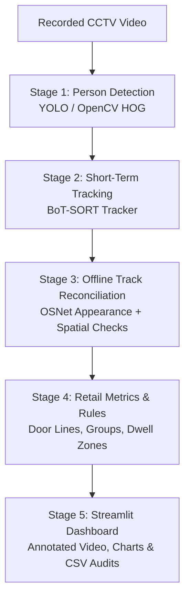

# Retail Flow CCTV Analytics — Comprehensive System Report

**Document Version:** 1.0  
**Target Audience:** Store Managers, Operations Leads, Product Executives, and Technical Teams  
**Application Workspace:** `poc_cctv_monet`  
**Primary Engine:** [`pipeline.py`](file:///d:/monet/poc_cctv_monet/poc/pipeline.py) | **UI Dashboard:** [`streamlit_app.py`](file:///d:/monet/poc_cctv_monet/poc/streamlit_app.py)

---

## 1. Executive Summary

**Retail Flow** is an automated video analytics solution engineered for physical retail stores. By analyzing standard recorded CCTV footage, the application translates raw camera feeds into actionable operational metrics—such as customer footfall, shopping party dynamics, customer dwell times in specific store aisles, and checkout queue duration.

Historically, acquiring this data required human auditors with clipboards or expensive proprietary sensor hardware (infrared beams, stereo overhead counters). Retail Flow leverages existing security camera infrastructure and state-of-the-art computer vision to generate these insights without requiring manual observation or compromising shopper privacy.

---

## 2. What the System Does (Business Capabilities)

The platform supports multiple camera perspectives (Entrance, Store Floor, and Checkout) to deliver five core business capabilities:

```
┌────────────────────────────────────────────────────────────────────────┐
│                        RETAIL FLOW CAPABILITIES                        │
├───────────────────┬──────────────────────┬─────────────────────────────┤
│ 1. Footfall &     │ Counts entrances and │ Informs peak staffing,      │
│    Traffic Flow   │ exits across doors   │ conversion rates, and hours │
├───────────────────┼──────────────────────┼─────────────────────────────┤
│ 2. Dwell & Store  │ Measures how long    │ Identifies hot spots, cold  │
│    Zone Hotspots  │ shoppers linger      │ aisles, and layout friction │
├───────────────────┼──────────────────────┼─────────────────────────────┤
│ 3. Shopping Party │ Identifies pairs and │ Differentiates solo buyers  │
│    Detection      │ families shopping    │ from multi-person groups    │
├───────────────────┼──────────────────────┼─────────────────────────────┤
│ 4. Staff / Cashier│ Filters fixed staff  │ Prevents employees from     │
│    Identification │ from customer counts │ inflating customer traffic  │
├───────────────────┼──────────────────────┼─────────────────────────────┤
│ 5. Checkout Queue │ Measures customer    │ Tracks service speed and    │
│    Presence       │ wait times at till   │ queue congestion patterns   │
└───────────────────┴──────────────────────┴─────────────────────────────┘
```

### Key Functional Areas
* **Entrance Monitoring:** Tracks directional crossings across a virtual boundary. It tells management how many people entered, how many left, and current net occupancy.
* **Store Floor Behavior:** Tracks visitor movement throughout aisles, measuring how many minutes shoppers spend browsing specific sections (e.g., front displays vs. back shelves).
* **Group & Family Identification:** Discovers whether customers are shopping alone or in groups (e.g., couples, parents with children) by analyzing shared walking paths and sustained proximity.
* **Fixed-Post Staff Detection:** Automatically identifies cashiers, greeters, or security staff standing in one location so their continuous presence does not falsely inflate visitor numbers.
* **Checkout Queue Timing:** Tracks customer presence windows in front of the payment desk to estimate queue waiting times.
* **100% Anonymous & Privacy-Compliant:** Does **not** capture facial features, identities, biometric profiles, gender, age, or payment credentials. It only recognizes general human shapes and anonymous visual clothing patterns.

---

## 3. How It Works (Step-by-Step Architecture)

The system breaks down complex video analysis into five sequential stages:



### Stage 1: Person Detection (Spotting People)
* **What happens:** Every sampled video frame is scanned for human figures.
* **Technology:** The engine utilizes Ultralytics YOLO (`yolo11x.pt` or `yolo11n.pt`). If running on low-resource machines without YOLO installed, it automatically switches to an OpenCV HOG pedestrian detector fallback.
* **Optimization:** Video frames are scaled to a standard processing width (default: 960 pixels) to ensure fast processing while preserving small or distant figures.

### Stage 2: Short-Term Tracking (Following Movement)
* **What happens:** Detections in consecutive frames are linked together into continuous paths called **"tracklets"**.
* **Technology:** Uses the **BoT-SORT** tracking algorithm. BoT-SORT predicts where a person will step next based on their velocity and bounding-box overlap.
* **Quality Filter:** Brief detection blips (e.g., shadows or rapid camera noise) are filtered out: a valid track must last at least 0.75 seconds, have at least 6 consecutive observations, and maintain a confidence score above 0.45.

### Stage 3: Offline Track Reconciliation (Stitching Lost Paths)
* **What happens:** In retail stores, customers frequently disappear for a few seconds behind high shelves, pillars, or displays. Traditional trackers would assign them a new ID when they step out, counting them as two separate people.
* **Technology:** Retail Flow uses **Re-Identification (ReID)** via an OSNet deep learning model (or an HSV clothing color model as fallback) coupled with a **Union-Find algorithm**.
* **Plausibility Checks:**
  1. *Appearance Match:* Do the clothing colors and texture signatures match?
  2. *Travel Plausibility:* Could a human physically walk the distance between the disappearance point and the reappearance point in the elapsed time?
  3. *Temporal Conflict Check:* If two tracks exist at the exact same second, they are **never** combined into one person.

### Stage 4: Retail Behavior & Rule Engines
Once clean customer paths are established, the engine calculates store metrics:
* **Entrance Line Crossing:** Uses an image-space virtual line. To eliminate counting jitter from people hesitating at the door, the system uses a **deadband barrier** and requires **two consecutive confirmations** on opposite sides before triggering an enter or exit count.
* **Shopping Group Formation:** Detects pairs or groups by measuring distance normalized by person height. If two people move in the same direction at similar speeds and stay close for at least 3 seconds, they are flagged as a group candidate. Group assignments are **"sticky"**—a shopper will not switch groups unless an alternative companion demonstrates stronger proximity for over 8 seconds.
* **Staff Filtering:** Detects individuals who remain in the frame for over 55% of the video duration within a tight radius (less than 0.9 body heights) and interact with multiple different shoppers.

### Stage 5: Reporting & Interactive Dashboard
The final results are compiled into:
* An **annotated MP4 video** with colored bounding boxes, customer IDs (`T0001 -> Visitor 1`), walking trails, and group highlight boxes.
* An interactive **Streamlit web application** ([`streamlit_app.py`](file:///d:/monet/poc_cctv_monet/poc/streamlit_app.py)) with timeline filters, event tables, and CSV/JSON downloads.

---

## 4. Why the Implementation Is Good (Key Strengths)

1. **Realistic & Honest Engineering (No Overpromising):**
   * Unlike black-box software that claims "99.9% accuracy," Retail Flow explicitly flags its metrics as *uncalibrated heuristic estimates*. It provides complete transparency into when fallback algorithms were used.
2. **Strict Physical Constraint Enforcement:**
   * Many retail trackers accidentally merge two different shoppers wearing similar dark coats. Retail Flow enforces a temporal exclusivity constraint: two tracks visible at the same moment can never be merged, eliminating impossible identity collisions.
3. **Perspective-Normalized Proximity:**
   * CCTV cameras view stores at an angle. Two people 100 pixels apart in the back of the store may be walking together, while two people 100 pixels apart in the front are far apart. Retail Flow normalizes pixel distances by person bounding-box heights, adapting automatically across the depth of field.
4. **Hysteresis-Guarded Doorway Counter:**
   * Prevents the common flaw of counting someone 15 times while they stand in a doorway deciding whether to enter or wait for a friend.
5. **Full Auditability:**
   * Every single tracking decision is written to `tracklets.csv` and `global_report.json`, allowing operators to verify exactly why a track was accepted or rejected.

---

## 5. How It Can Be Better (Recommended Enhancements)

While the current codebase is functionally solid, the following enhancements would elevate it from a proof-of-concept into a commercial-grade product:

### 1. Interactive Polygon Zone Mapping (High Priority)
* **Current State:** The store floor is partitioned into rigid vertical columns or quadrants.
* **Recommendation:** Add a point-and-click polygon drawing tool inside Streamlit so store managers can draw boundaries around specific product departments (e.g., *"Perfume Display"*, *"Footwear Wall"*, *"Checkout Queue"*).
* **Business Benefit:** Yields department-level dwell times and engagement rates that map directly to merchandise sales.

### 2. Ground-Plane Camera Calibration / Homography (High Priority)
* **Current State:** Perspective is estimated using bounding-box heights as a proxy for scale.
* **Recommendation:** Allow users to calibrate the camera by clicking four floor points of a known rectangle (e.g., standard floor tiles or a $2\text{m} \times 2\text{m}$ area).
* **Business Benefit:** Converts screen pixels into true real-world meters. This enables exact physical distance measurements (e.g., "1.5 meters apart") and true walking speeds ($\text{m/s}$ or $\text{km/h}$).

### 3. Occlusion-Safe Visual Feature Updating (Medium Priority)
* **Current State:** The OSNet visual descriptor updates continuously on every frame.
* **Recommendation:** Pause appearance updates when a person is partially blocked by a shopping cart, counter, or another shopper (detected via sudden box overlap or lower detector confidence).
* **Business Benefit:** Prevents temporary occlusions from corrupting a person's clothing signature, improving re-identification accuracy.

### 4. Automated Multi-Camera Customer Journey Mapping (Medium Priority)
* **Current State:** Each camera clip produces isolated local IDs; cross-camera links require manual timeline offsets.
* **Recommendation:** Implement a store transition graph with logical travel-time windows (e.g., a customer passing the Entrance camera at 10:00:00 will reach the Floor camera between 10:00:05 and 10:00:30).
* **Business Benefit:** Unifies customer journeys into a single end-to-end profile (Entry $\rightarrow$ Browsing $\rightarrow$ Checkout) across multiple camera feeds.

### 5. High-Throughput Batch Inference & GPU Acceleration (Medium Priority)
* **Current State:** Frames are processed sequentially one-by-one.
* **Recommendation:** Enable batched tensor inference with PyTorch/TensorRT and allow GPU video decoding via NVDEC.
* **Business Benefit:** Accelerates processing from near-real-time up to $3\times$ to $5\times$ real-time speed, enabling rapid processing of multi-hour recorded footage.

---

## 6. Summary Comparison Matrix

| Aspect | Current Implementation | Proposed Future Enhancement |
| :--- | :--- | :--- |
| **Detection Engine** | YOLO11 / OpenCV HOG fallback | YOLO11 with TensorRT / ONNX batch acceleration |
| **Tracking** | BoT-SORT + Offline ReID (OSNet) | BoT-SORT + Occlusion-gated ReID |
| **Store Zones** | Uniform columns or quadrants | Freeform interactive polygon zones |
| **Distance & Speed** | Normalized box-height proxy | Calibrated ground-plane homography (meters & km/h) |
| **Multi-Camera Flow** | Camera-local counts with manual review | Automated timeline transition graph |
| **Privacy Protection** | Anonymous, no facial/biometric data | Fully retained; privacy-by-design |

---

*Report compiled for the Retail Flow Proof-of-Concept workspace.*
